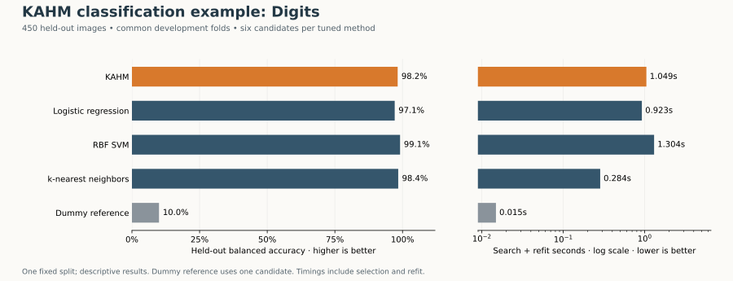
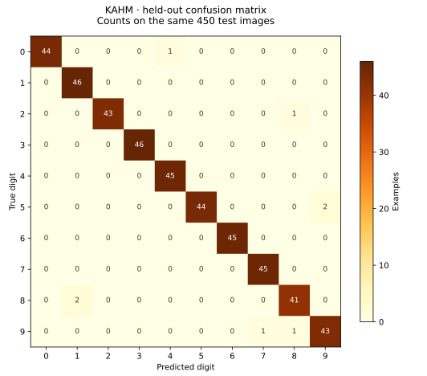

# KAHM classification example: Digits

**Status: complete.**

This is a tutorial benchmark on one fixed held-out split, not a claim of general superiority.

The dataset has 1,797 examples, 64 raw image features, and 10 classes. There are 1,347 development and 450 test examples. Every tuned method receives the same three development folds and six candidate pipelines. All searches finish before any held-out prediction is evaluated. The dummy has one candidate.

## Held-out results

| Method | Accuracy | Balanced accuracy | Macro F1 | Search + refit (s) | Predict 450 examples (s) |
|---|---:|---:|---:|---:|---:|
| KAHM | 0.9822 | 0.9821 | 0.9821 | 1.0488 | 0.041575 |
| Logistic regression | 0.9711 | 0.9711 | 0.9710 | 0.9229 | 0.002425 |
| RBF SVM | 0.9911 | 0.9910 | 0.9911 | 1.3045 | 0.029507 |
| k-nearest neighbors | 0.9844 | 0.9841 | 0.9842 | 0.2842 | 0.015971 |
| Dummy (most frequent) | 0.1022 | 0.1000 | 0.0185 | 0.0149 | 0.000188 |

Selection used development balanced accuracy only. Equal candidate counts do not equate model capacity or computation, and these small grids are not exhaustive tuning. There are no significance tests or population confidence intervals. Test examples are from one dataset, not independent domains.

## Selected configurations

| Method | Mean development balanced accuracy | Selected parameters |
|---|---:|---|
| KAHM | 0.9867 | `{"model__subspace_dim": 16, "scale": "MinMaxScaler(-1,1; clip=False)"}` |
| Logistic regression | 0.9553 | `{"model__C": 1.0, "scale": "MinMaxScaler(-1,1; clip=False)"}` |
| RBF SVM | 0.9874 | `{"model__C": 10.0, "scale": "MinMaxScaler(-1,1; clip=False)"}` |
| k-nearest neighbors | 0.9793 | `{"model__n_neighbors": 1, "scale": "MinMaxScaler(-1,1; clip=False)"}` |
| Dummy (most frequent) | 0.1000 | `{}` |

## Interpretation

KAHM obtains 98.22% accuracy and 98.21% balanced accuracy on the held-out images. The complete table includes favorable and unfavorable comparisons.
The highest observed baseline balanced accuracy belongs to RBF SVM; KAHM's difference is -0.89 percentage points. This is a descriptive comparison after evaluation, not another model-selection step or evidence across datasets.
The refitted KAHM contains 20 local reference models and 1347 retained reference observations.

## Timing scope and warnings

Search time includes fold-local preprocessing, validation fits, model selection, and the final refit. Prediction time includes the selected scaler and classifier for all 450 test examples. Imports, shared data loading, plotting, and artifact writing are excluded. Each duration is one wall-clock measurement, with serial search and one numerical-library thread; it depends on this implementation and environment.

No fitting or prediction warnings were captured.

## Provenance

- Protocol: `digits-classification-v1`.
- Protocol SHA-256: `3f4196817afe607078cd8c679a1a3976eccc8232719f293adb79f71f728704db`.
- Dataset SHA-256: `f6d9e39f37dc45d327f6db33428ee58970ccceabb2535a5c179de35886b70443`.
- Run started (UTC): `2026-10-30T20:24:07.589034+00:00`.
- Python 3.12.14; NumPy 2.3.5; scikit-learn 1.8.0; KAHM 0.1.0.
- Platform: Linux-6.18.57-x86_64-with-glibc2.39 (x86_64).

See `results.json` for the complete environment and executed source hashes, `splits.json` for the exact indices, `cv_results.csv` for every validation candidate, and `predictions.csv` for all selected-model test predictions. Protocol details are in `examples/PROTOCOL.md` in the repository.

KAHM scores are not assumed to be calibrated probabilities. This example evaluates class labels only.
